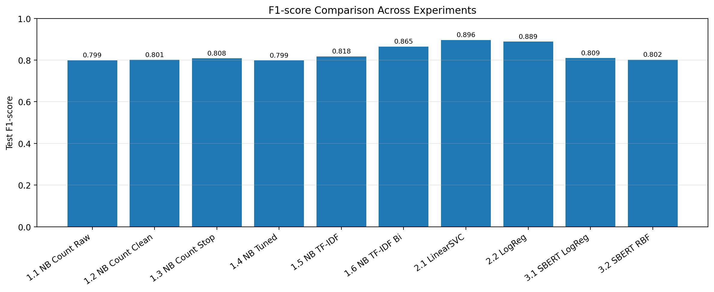
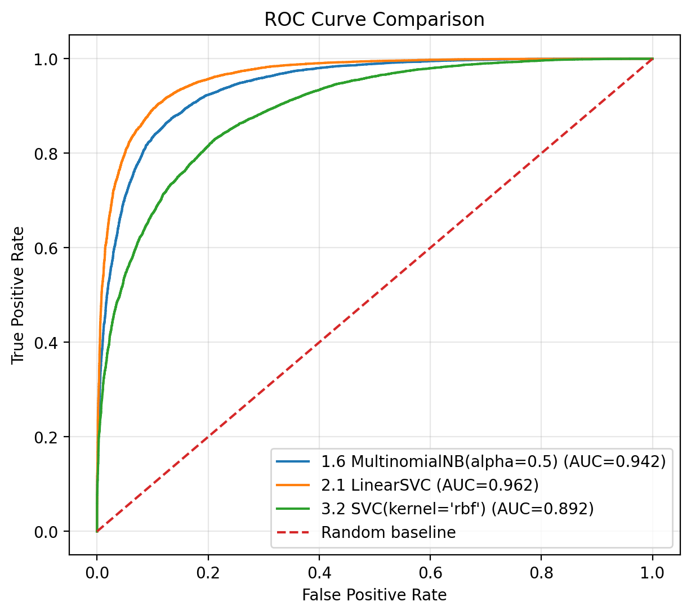
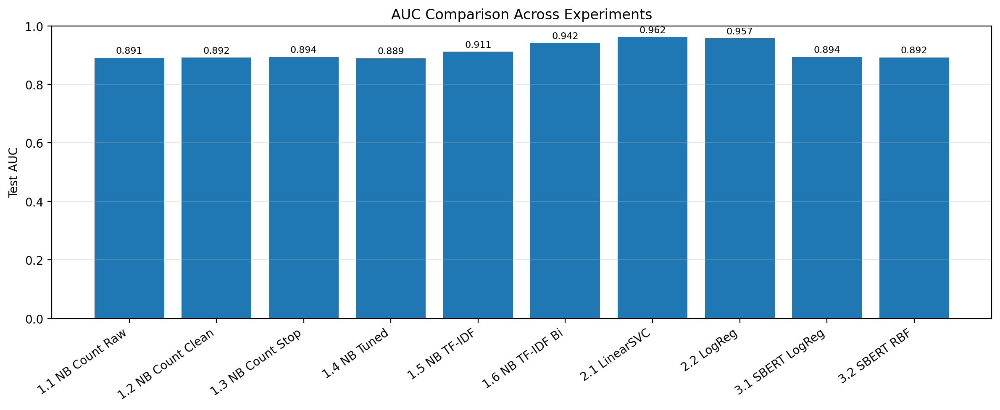
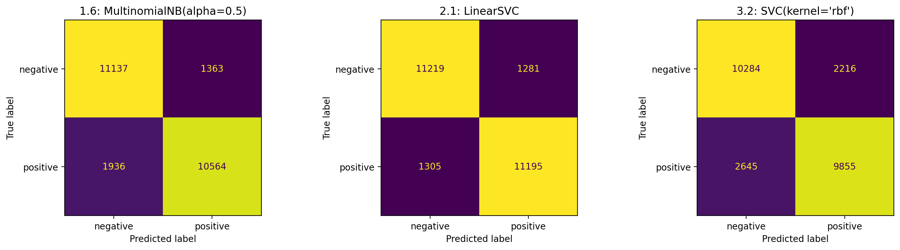
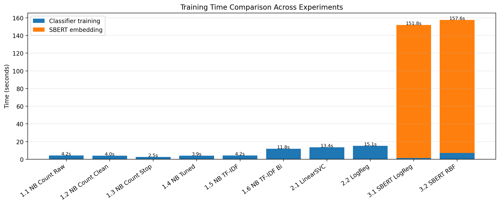
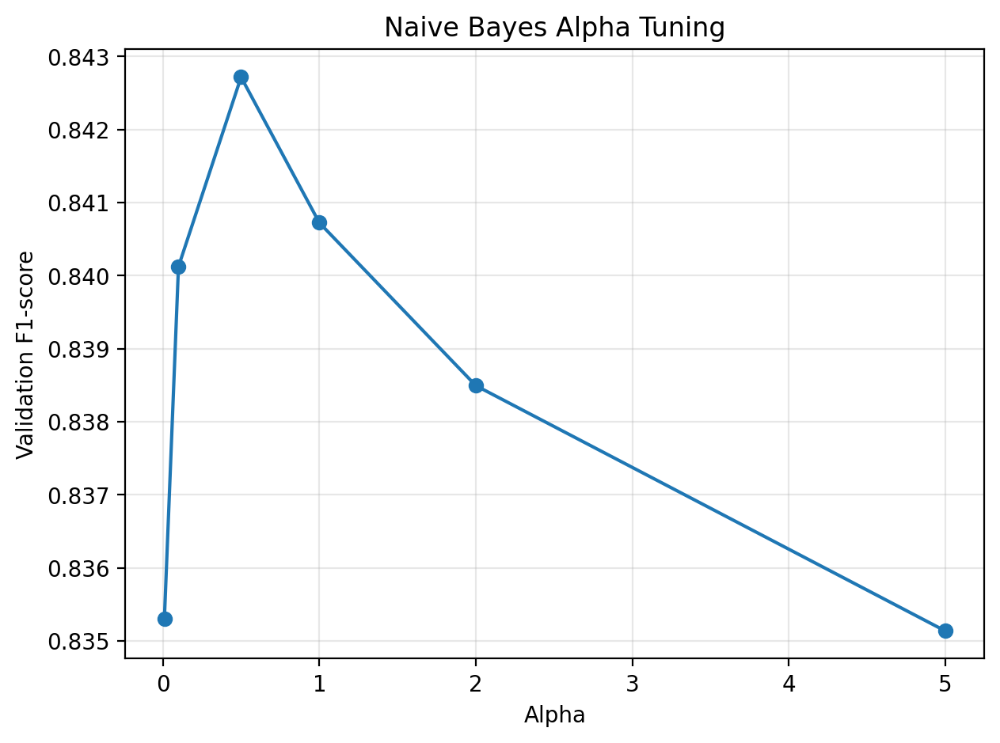

# IMDb Sentiment Analysis: Naive Bayes vs Linear Models vs SBERT

[](https://colab.research.google.com/github/watchcat2077/imdb-sentiment-analysis/blob/main/notebooks/imdb_sentiment_experiments.ipynb)


A controlled experiment on 50,000 IMDb movie reviews that asks a practical question:
**how much does each modelling choice actually buy you in sentiment classification?**

Starting from a bag-of-words Naive Bayes baseline, we change one thing at a time (text cleaning,
stop-words, smoothing, TF-IDF, n-grams), then swap the classifier, then swap the text
representation for SBERT sentence embeddings. Every configuration is selected on a held-out
validation split and reported once on the untouched 25,000-review test set.

> Group project for **CSCI323 Modern Artificial Intelligence**, University of Wollongong (Autumn 2026), Group 16.

## Results at a glance

| Tier | Best configuration (chosen on validation F1) | Test accuracy | Test F1 | Test ROC-AUC |
|---|---|---:|---:|---:|
| 1. Naive Bayes | TF-IDF unigram + bigram, MultinomialNB (α = 0.5) | 0.868 | 0.865 | 0.942 |
| 2. Linear models | TF-IDF unigram + bigram, **LinearSVC** | **0.897** | **0.896** | **0.962** |
| 3. Sentence embeddings | SBERT `all-MiniLM-L6-v2`, Logistic Regression | 0.811 | 0.809 | 0.894 |

What the ablations showed:

- **Bigrams beat cleaning by a wide margin.** Basic text cleaning moved test F1 by +0.002 (0.799 → 0.801).
  Adding bigrams to TF-IDF moved it by +0.047 (0.818 → 0.865), because short phrases such as *"not good"* become features.
- **Discriminative beats generative on the same features:** LinearSVC 0.896 F1 vs Naive Bayes 0.865.
- **Newer is not automatically better.** Frozen SBERT embeddings, without fine-tuning, reached about 0.81 F1 on long reviews
  (about 233 words on average). That is below TF-IDF + LinearSVC, and the embedding step cost about 150 s on a Colab T4 GPU.
- The remaining errors cluster around negation with contrast, sarcasm, and mixed or implicit sentiment
  (see [`results/error_analysis_10_examples.csv`](results/error_analysis_10_examples.csv)).



<details>
<summary>More charts: ROC curves, AUC, confusion matrices, training time, alpha tuning</summary>







</details>

## Experiment design

| ID | Tier | What changes | Text input | Features | Classifier |
|---|---|---|---|---|---|
| 1.1 | 1 | Baseline | Raw text | Count, unigram | MultinomialNB |
| 1.2 | 1 | Basic preprocessing | Cleaned text | Count, unigram | MultinomialNB |
| 1.3 | 1 | Stop-word removal | Cleaned, no stop-words | Count, unigram | MultinomialNB |
| 1.4 | 1 | Laplace smoothing α (0.01 to 5) | Cleaned text | Count, unigram | MultinomialNB, tuned α |
| 1.5 | 1 | Count vs TF-IDF | Cleaned text | TF-IDF, unigram | MultinomialNB |
| 1.6 | 1 | Add bigrams | Cleaned text | TF-IDF, unigram + bigram | MultinomialNB |
| 2.1 | 2 | Linear SVM | Best Tier 1 setting | Best Tier 1 features | LinearSVC |
| 2.2 | 2 | Logistic Regression | Best Tier 1 setting | Best Tier 1 features | LogisticRegression |
| 3.1 | 3 | Sentence embeddings | HTML-cleaned text | SBERT `all-MiniLM-L6-v2` | LogisticRegression |
| 3.2 | 3 | Non-linear classifier | HTML-cleaned text | SBERT `all-MiniLM-L6-v2` | SVC (RBF kernel) |

**Data.** [`stanfordnlp/imdb`](https://huggingface.co/datasets/stanfordnlp/imdb) from Hugging Face. The official 25k training set is
split 20k train / 5k validation (stratified, `random_state=42`). The official 25k test set is used only for final reporting.
Both classes are perfectly balanced.

**Evaluation.** Accuracy, precision, recall, F1 and ROC-AUC on validation and test, per-class metrics,
confusion matrices, training-time comparison, and a qualitative error analysis of the most confident mistakes.

## Repository layout

```text
notebooks/imdb_sentiment_experiments.ipynb   full pipeline (data → features → models → evaluation), with outputs
results/                                     result tables written by the notebook (CSV)
results/figures/                             charts used in the report
requirements.txt
```

## Run it

**Google Colab (easiest):** click the *Open in Colab* badge, choose *Runtime → Change runtime type → GPU*
(only the SBERT step needs it), then *Run all*.

**Locally:**

```bash
python -m venv .venv
source .venv/bin/activate        # Windows: .venv\Scripts\activate
pip install -r requirements.txt
jupyter notebook notebooks/imdb_sentiment_experiments.ipynb
```

Notes for local runs:

- In *Step 1*, set `OUTPUT_DIR` to a local folder (the default is the Colab path `/content/csci323_outputs`).
- Set `QUICK_MODE = True` to smoke-test on a stratified 4k/1k/4k sample. Set `RUN_TIER3 = False` to skip SBERT.
- The final cell zips the outputs with `google.colab.files`, so skip it outside Colab.

## My contribution

I (Zihua "Andy" Zeng) led the project design and experiment planning, implemented the notebook end to end,
and ran the result analysis, including the ROC/AUC comparison. I also co-wrote the conclusion and reviewed the report.

## Team

Group 16: Fei Teng, Qianran Xu, Ciara Slater, Yuhan Zhu, Zihua Zeng.

## Acknowledgements

- The baseline code structure was adapted from [windi-wulandari/sentiment-analysis-IMDB](https://github.com/windi-wulandari/sentiment-analysis-IMDB).
- Dataset: A. Maas et al., *Learning Word Vectors for Sentiment Analysis*, ACL 2011.
- Sentence embeddings: [`sentence-transformers/all-MiniLM-L6-v2`](https://huggingface.co/sentence-transformers/all-MiniLM-L6-v2).
